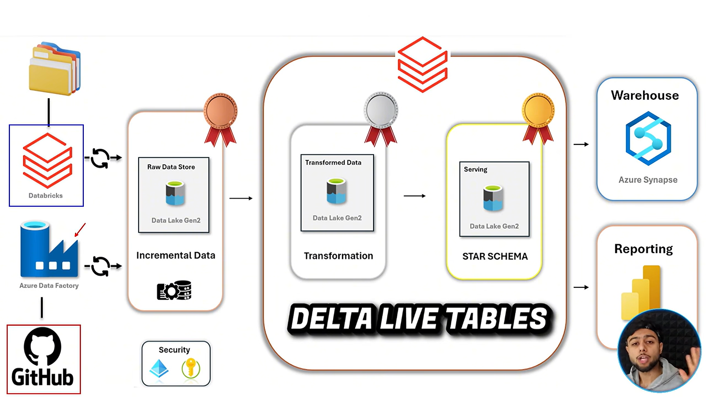

# Building an End-to-End Data Engineering Solution with Azure and Databricks ✨

This project demonstrates an end-to-end data engineering pipeline using Azure services and Databricks. It ingests the Netflix Movies and TV Shows dataset, loads lookup files from GitHub with Azure Data Factory, loads the master titles file incrementally with Databricks Auto Loader, transforms the data with PySpark and Databricks Workflows, builds the gold layer with Delta Live Tables, and serves the data to Power BI through a SQL warehouse. Everything is governed by Unity Catalog.

## Project Architecture



## Architecture Overview

### Azure services used

- **Azure Data Factory (ADF):** Ingests the lookup files from GitHub with a parameterized, validated pipeline.
- **Azure Data Lake Storage Gen2:** Stores data in the Raw, Bronze, Silver, and Gold layers.
- **Azure Databricks:** Loads files incrementally with Auto Loader, transforms data with PySpark, and orchestrates notebooks with Workflows.
- **Unity Catalog:** Governs data access through a metastore, catalog, storage credential, and external locations.
- **Delta Live Tables (DLT):** Builds the Gold layer with streaming tables, views, and data quality expectations.
- **Databricks SQL Warehouse:** Serves curated data to analysts and BI tools.
- **Power BI:** Connects to the lakehouse to build dashboards.

> **Note:** Raw, Bronze, Silver, and Gold are separate containers in the same storage account. Raw is the landing zone for new files, and no transformations are applied in it.

### Dataset

Netflix Movies and TV Shows, originally from Kaggle, converted from Excel to CSV.

| File | Type | Description |
|---|---|---|
| `netflix_titles.csv` | Master data | Title, type, release year, rating, duration, description, show ID |
| `netflix_directors.csv` | Lookup | Directors per show |
| `netflix_cast.csv` | Lookup | Cast per show |
| `netflix_category.csv` | Lookup | Categories per show |
| `netflix_countries.csv` | Lookup | Countries per show |

## Step 1: Setting Up the Azure Environment ⚙️

The Azure resources used in this project are:

1. **Resource group** (`RG-Netflix-project`, Canada Central): one folder that holds every resource of the project.
2. **Storage account with ADLS Gen2:** hierarchical namespace enabled so it behaves as a real data lake, with LRS redundancy because it is the cheapest option.
3. **Containers:** `raw`, `bronze`, `silver`, and `gold`.
4. **Azure Data Factory:** data ingestion and orchestration.
5. **Azure Databricks workspace:** transformation and processing (trial tier, because Unity Catalog needs premium features).

## Step 2: Implementing the Data Pipeline Using ADF 🚀

Azure Data Factory copies the lookup files from GitHub into the Bronze layer of ADLS Gen2.

### Linked services

| Name | Type | Authentication | Purpose |
|---|---|---|---|
| GitHub connection | HTTP | Anonymous | Pulls CSV files directly from the GitHub raw URL |
| Data lake connection | ADLS Gen2 | Account key | Writes into the storage account |

HTTP is used instead of REST because the pipeline reads raw files from a URL rather than a JSON API response.

### Datasets

| Dataset | Format | Parameters | Purpose |
|---|---|---|---|
| GitHub source | HTTP, CSV | `file_name` | The relative URL ends with the file name parameter |
| Data lake sink | ADLS Gen2, CSV, container `bronze` | `folder_name`, `file_name` | Folder and file name come from parameters |
| Validation dataset | ADLS Gen2, CSV, container `raw` | none | Points to the titles file in the raw container |

### Pipeline activities

1. **Pipeline parameter (`p_array`)**
   - An array with four items, each holding a `folder_name` and `file_name` for cast, category, countries, and directors.
   - Stored as a parameter instead of a JSON file, so nothing extra has to be moved between dev, test, and prod.

2. **Validation activity**
   - Waits until the titles file exists in the raw container.
   - Stops the pipeline from moving forward without data.

3. **ForEach activity**
   - Iterates through `p_array` and runs in parallel to save time.

4. **Dynamic Copy activity**
   - Uses `@item().file_name` and `@item().folder_name` for the source and sink.
   - Settings: 12-hour timeout, 0 retries, 30-second retry interval.

5. **Web activity and Set Variable**
   - Fetch the GitHub metadata with a GET request and store the response in a variable.

6. **Alerts and Metrics**
   - An alert rule sends an email notification when a pipeline fails.

After a successful run, verify that four folders exist in the Bronze container, each with its file.

## Step 3: Storing Raw Data in the Bronze Layer

The Bronze layer stores the files exactly as they were copied from the source. Keeping the original data makes it easier to trace issues and rerun transformations.

## Step 4: Databricks and Unity Catalog Setup 🔐

Unity Catalog is used because the legacy Hive metastore and credential passthrough are being retired.

| Step | What and why |
|---|---|
| Access connector for Azure Databricks | A managed identity, because Databricks cannot access the data lake directly |
| Role assignment | **Storage Blob Data Contributor** for the access connector on the storage account |
| Delete the default metastore | Only one metastore is allowed per region |
| Create a metastore | Region Canada Central, ADLS path to a dedicated `metastore` container, access connector resource ID |
| Assign the metastore to the workspace | Done manually |
| Admin setup | Users are managed in the account console, then roles are set in the workspace |
| Catalog | `netflix_catalog` (standard type, no extra storage location) |
| Storage credential | Wraps the access connector |
| External locations | `bronze`, `silver`, `gold`, and `raw`, each created at container level |
| Schema | Created under the catalog |
| Compute | Personal compute with Unity Catalog, long-term support runtime, auto-terminate after 20 minutes |

## Step 5: Incremental Loading with Auto Loader 🔄

The master titles file arrives in the raw container, and new files are expected every week. Auto Loader loads only the new files into Bronze.

```python
df = (spark.readStream
      .format("cloudFiles")
      .option("cloudFiles.format", "csv")
      .option("cloudFiles.schemaLocation", checkpoint_location)
      .load("abfss://raw@<storage_account>.dfs.core.windows.net/"))

(df.writeStream
   .option("checkpointLocation", checkpoint_location)
   .trigger(processingTime="10 seconds")
   .start("abfss://bronze@<storage_account>.dfs.core.windows.net/netflix_titles"))
```

### How it works

- **Detection mode:** directory listing, which uses storage APIs to find new files. File notifications are the alternative and need extra setup.
- **Schema location:** stores the inferred schema.
- **Checkpoint (RocksDB):** tracks which files have been read and guarantees exactly-once processing.
- **Schema evolution:** when a new column arrives, the new schema is saved first, the stream fails once, and a rerun succeeds with the updated schema.
- **Output:** Delta format, written to a path, so the table is external.
- **Cost control:** stop the stream when it is not needed so the cluster does not keep running.

## Step 6: Silver Layer with PySpark and Workflows 🛠️

### Notebooks

| Notebook | Purpose |
|---|---|
| Silver (lookup tables) | Uses widgets `source_folder` and `target_folder`, reads CSV from Bronze, writes Delta to Silver |
| Lookup array | Holds the four folder pairs and returns them with `dbutils.jobs.taskValues.set` |
| Silver titles | PySpark transformations on the master data |
| Weekday lookup | Returns the ISO weekday as a task value |
| Fallback | Prints the weekday value when the condition is false |

### Titles transformations

1. Fill nulls with a dictionary of per-column defaults (`duration_minutes` to 0, `duration_seasons` to 1).
2. Cast both duration columns from string to integer.
3. Split the title on the colon and the rating on the hyphen, keeping the first part.
4. Create a `type_flag` with `when/otherwise` (movie = 1, TV show = 2, anything else = 0) to catch corrupted records.
5. Rank titles by duration with the `dense_rank` window function.
6. Demonstrate temp views and global temp views.
7. Aggregate the count by type and show it as a pie chart in the notebook.
8. Write the result to Silver in Delta format with `overwrite` mode.

### Workflows

| Workflow | Tasks | Why |
|---|---|---|
| Silver lookup tables | Lookup task returns `my_array`, then a For each loop runs the silver notebook with `{{input.source_folder}}` and `{{input.target_folder}}` | One notebook loads all four tables with no repeated code |
| Master data on Sundays | Weekday lookup, then an If/else on `week_output == 7`: true runs the titles notebook, false runs the fallback notebook | Demonstrates conditional execution |

A failed task can be fixed with **Repair run**, which reruns only the failed part.

## Step 7: Gold Layer with Delta Live Tables 🥇

- **Lookup tables:** streaming tables (`@dlt.table`) for directors, cast, countries, and category, read from Silver with `readStream`.
- **Expectations:** the rule `show_id IS NOT NULL` is applied with `expect_all_or_drop`.
- **Titles flow:** a staging streaming table, then a streaming view that adds a `new_flag` column, then the final Gold streaming table with expectations on `new_flag` and `show_id`.
- **Expectation actions:** `expect` warns (default), `expect_or_drop` removes failing rows, and `expect_or_fail` stops the pipeline.
- **Pipeline settings:** triggered mode, Unity Catalog, `netflix_catalog`, a new schema, and a small worker. The all-purpose cluster must be terminated first because of the 10-core quota.
- **Result:** 4 records were dropped by the quality rules, and a rerun wrote 0 records because DLT loads incrementally.

## Step 8: Serving with SQL Warehouse and Power BI 📈

- A **SQL warehouse** is compute optimized for SQL and BI workloads, with query caching.
- **Partner Connect** generates a Power BI connection file (`.pbids`) with the connection details already filled in, which can be handed to analysts.
- Azure Synapse can be added as a warehouse replica if the business requires it.

## End-to-End Data Flow

```text
GitHub lookup files                 Weekly titles file
        ↓                                   ↓
 Azure Data Factory                  ADLS Gen2 Raw
 (Validation, ForEach, Copy)                ↓
        ↓                            Auto Loader
        └──────────────┬─────────────────┘
                       ↓
               ADLS Gen2 Bronze
                       ↓
   Databricks notebooks and Workflows (PySpark)
                       ↓
               ADLS Gen2 Silver
                       ↓
          Delta Live Tables (Gold)
                       ↓
              Databricks SQL Warehouse
                       ↓
                    Power BI
```

## Security and Reliability

- Use an access connector (managed identity) with the minimum required role instead of account keys inside Databricks.
- Govern data access through Unity Catalog external locations at container level.
- Keep credentials and secrets out of notebooks, pipeline parameters, and GitHub.
- Use the Validation activity so the pipeline runs only when the source file exists.
- Monitor ADF runs and set up failure alerts.
- Rely on Auto Loader checkpoints for exactly-once file processing.
- Use DLT expectations to enforce data quality in the Gold layer.
- Terminate clusters and stop streams when finished to control cost.

## Lessons Learned

- Remove spaces from the ADF array parameter, or validation fails.
- Create an external location for every container, including Raw.
- Auto Loader writes Delta, so downstream reads must use the Delta format, not CSV.
- Forgetting the `f` prefix on an f-string path creates a folder with a literal name.
- DLT column names must match exactly (`show_id`, not `showid`).
- Delta Live Tables was still in preview when the original tutorial was recorded.

## Conclusion

This project demonstrates how Azure and Databricks can work together to build a practical data engineering solution: ADF handles ingestion, Auto Loader loads new files incrementally, parameterized notebooks and Workflows build the Silver layer, Delta Live Tables enforce quality in the Gold layer, Unity Catalog governs access, and Power BI presents the results.
